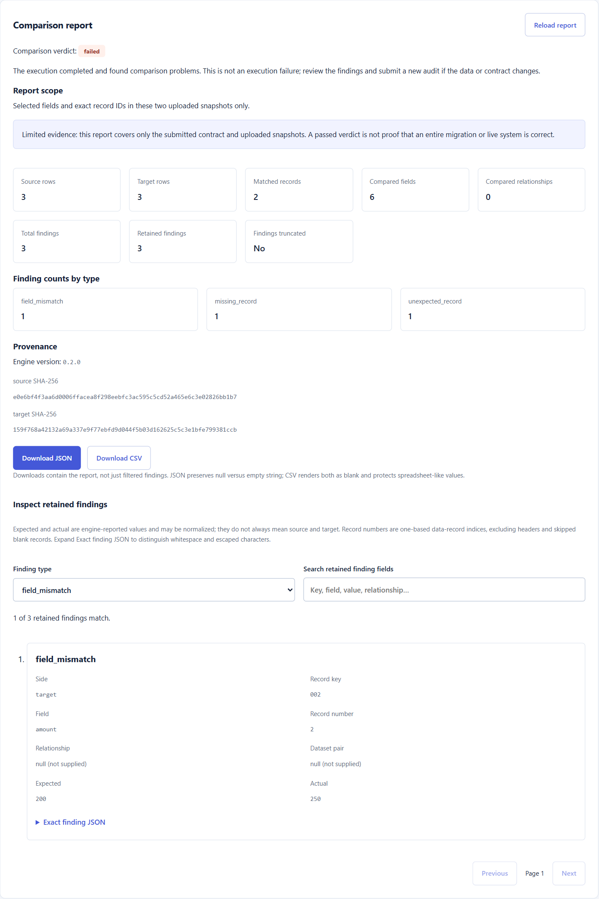

# CRM Migration Auditor

A local, single-user application for verifying CRM migration CSV exports before
cutover. The React workspace supports project creation, immutable uploads, explicit
field and relationship contracts, audit history, evidence review, and JSON/CSV
downloads. FastAPI, SQLAlchemy, and a pure Python comparison engine provide the
same workflow through an API; PostgreSQL and Celery are optional.

**What it demonstrates:** deterministic comparison rather than fuzzy guessing,
exact ID crosswalks, uncertainty-aware verdicts, checksum provenance, immutable
contracts, bounded evidence, project-scoped access, and real-browser integration
with a persisted backend.

**Scope:** a local portfolio application using synthetic data, not a public SaaS.
It never contacts or modifies a CRM. A passed report verifies only the uploaded
snapshots and declared rules, not the completeness of an entire migration.



The screenshot is from the working application, not the design gallery.

## Interview preparation

Read the [eight-page interview guide (PDF)](docs/crm-migration-auditor-interview-guide.pdf)
for the study sequence, build walkthrough, demo checklist, and 16 project-specific
interview questions with answer outlines. The [editable, printable HTML source](docs/crm-migration-auditor-interview-guide.html)
is self-contained and can be opened directly in a browser.

## Local setup

Use **Python 3.14**. Create a dedicated `.venv`, install the exact tested
base/development dependencies, and install this project without resolving them again:

```powershell
py -3.14 -m venv .venv
.\.venv\Scripts\python.exe -m pip install --upgrade pip
.\.venv\Scripts\python.exe -m pip install -r requirements-dev.lock
.\.venv\Scripts\python.exe -m pip install --no-deps -e .
.\.venv\Scripts\python.exe -m uvicorn main:app --reload --host 127.0.0.1 --port 8000
```

Your existing PyCharm **FastAPI** run configuration still targets `main.py`.
Alternatively, run `main.py` directly. Set the working directory to the project root.

Open <http://127.0.0.1:8000/docs>. SQLite and the upload directory are created under
`.data/` at startup. No Docker, Redis, cloud account, or AI key is needed locally.
Ignored virtual environments from other tools are not part of this setup; use the
same `.venv` interpreter for installation, checks, and runtime commands.

Run the synthetic example in a second terminal while the server is running:

```powershell
.\.venv\Scripts\python.exe scripts/demo.py --export-dir .data/demo-exports
```

This creates a new project, uploads two sample files, submits the sample contract,
polls the job, prints its report, and saves deterministic JSON and CSV report
downloads. The expected result is **completed** with a **failed** verdict: one missing
record, one unexpected record, and one changed amount. "Completed" describes
successful execution; "failed" describes the data comparison. Each demo invocation
creates a separate project.

`test_main.http` provides the same workflow in PyCharm's HTTP client, capturing IDs
from preceding responses. Swagger also supports manual file uploads and submissions.

## React frontend

The independent `frontend/` app uses **React 19**, **Vite 8**, and JavaScript/JSX.
The responsive **Atlas** workspace provides:

- Paginated projects and audit history, project creation, and backend readiness.
- Source/target CSV uploads with exact headers, row counts, and snapshot identity.
- A visual contract builder: field mappings, ordered normalizers, value maps,
  decimal tolerances, primary ID maps, parent pairs, and relationship rules.
- Automatic queued/running status updates, execution retry for failed jobs,
  immutable submitted contracts, and distinct execution status/comparison verdict.
- Report scope, counts, SHA-256 provenance, retained-finding filters/search,
  exact JSON evidence, and complete JSON/spreadsheet-safe CSV downloads.

Swagger remains available for direct API access. Design-gallery fixtures are
isolated from the real workspace.

### Run locally

Start FastAPI using the local setup above. In a second terminal, use **Node.js 24
LTS** (Vite also supports Node 20.19+ or 22.12+):

```powershell
cd frontend
npm ci
npm run dev
```

Open <http://127.0.0.1:5173>. Vite provides React Fast Refresh during development.
The frontend and backend are separate processes; neither starts the other.
Ports are strict, so an occupied port produces an error rather than silently
opening the UI on another port.

### First review: no files to prepare

On the home page, select **Run synthetic demo**. It creates a real project,
uploads the canonical `examples/source.csv` and `examples/target.csv`, and submits
`examples/contract.json` through the normal API. Review opens automatically.
The expected execution is **completed**, with comparison verdict **failed**:
one changed amount (record `002`, `200` → `250`), one missing record (`003`),
and one unexpected record (`004`). Email normalization and stage translations
pass. Each invocation creates a separate project; no sample data is inserted on
startup.

Filter by `field_mismatch`, search for `002`, expand **Exact finding JSON**, then
download JSON and CSV. Downloads cover the report, not the active filter.
Open **Audit history** and reopen the run to see persisted evidence.

To configure your own synthetic audit:

1. Create a project; upload a source and target CSV in **Datasets**.
2. Open **New audit**; select both snapshots and their exact record-ID columns.
3. Add field mappings or relationship rules; review the contract JSON preview.
4. Select **Create audit**, then inspect the verdict, scope, findings, and hashes.

Relationship checks also require uploaded parent source/target snapshots and a
named parent pair. The bundled three-record demo covers fields, not relationships.
Builder drafts survive switching project tabs but are not saved when leaving the
project. A changed input or rule requires a new audit; historical runs are immutable.

By default, Vite forwards `/api`, `/health`, `/docs`, and `/openapi.json` to
`http://127.0.0.1:8000`, preserving paths. Browser requests stay on the frontend
origin, so this setup needs no FastAPI CORS changes.

For another backend address or an API-key-protected backend:

```powershell
# From frontend/
Copy-Item .env.example .env.local
```

Edit `frontend/.env.local`:

```dotenv
API_PROXY_TARGET=http://127.0.0.1:8000
API_PROXY_KEY=
```

Set `API_PROXY_KEY` to the same value as the backend's `AUDITOR_API_KEY` when
required, then restart Vite. These values are read by Vite's Node process.
The key is added to `/api` proxy requests as `X-API-Key`, not embedded in React
or saved in browser storage. Never rename it with a `VITE_` prefix: that prefix
exposes values to client code. `.env.local` is ignored by Git.

Both Vite servers bind to localhost. Anyone who can access the proxy can use its
configured API key; it is a local-development convenience, not user authentication.
Opening Swagger through the frontend uses this proxy. Opening Swagger directly
on port 8000 still requires its **Authorize** button when a key is configured.

### Compare frontend designs

Open <http://127.0.0.1:5173/designs.html> or use **Design previews** in the working
app's sidebar (below the navigation on mobile). Three separate visual concepts are available:

| Design | Direction | Preview interaction |
| --- | --- | --- |
| Atlas | Light operations dashboard, cobalt accents, sidebar navigation | Search findings and select record evidence |
| Signal | Dark technical console, cyan/lime accents, dense audit details | Filter finding types and compare source/target values |
| Fieldwork | Warm editorial layout, serif headings, guided review | Navigate exports/rules/evidence and expand findings |

Each design has a direct link, for example
`/designs.html?design=signal`. Missing or unknown design names show Atlas.
Use the top cards to compare concepts; choosing one does not change the working
app or persist a preference.

The gallery uses explicitly synthetic fixtures from
`frontend/src/designs/sampleData.js`; it makes no API requests and does not upload,
run, or save audits. **FastAPI is not required to view the design gallery.**
The sample has 240 records on each side, 239 shared IDs, 238 unchanged records,
and three findings: one changed, one missing, and one unexpected record.
Execution is completed while the audit verdict is failed.

`frontend/designs.html` is a separate Vite entry with its own gallery and scoped
template styles in `src/designs/`. The production build includes both HTML entry
points, so the same gallery is available at
<http://127.0.0.1:4173/designs.html> after `npm run build` and `npm run preview`.
The real workspace's bundle does not import the design templates.

### Structure and data flow

```text
frontend/
  index.html                    HTML document and React root element
  designs.html                  Separate synthetic design-gallery entry
  package.json                  npm scripts and exact direct dependencies
  package-lock.json             Reproducible dependency tree for npm ci
  vite.config.js                React plugin, local servers, backend proxy
  .env.example                  Optional server-side proxy settings
  src/
    main.jsx                    Mounts React with development StrictMode
    App.jsx                     Page shell, project/audit hash routes, refresh
    api.js                      JSON requests, uploads, report downloads, errors
    hooks/useApiResource.js      Loading/success/error state and cancellation
    hooks/useRoute.js            Route parsing, UUID canonicalization, focus
    components/
      BackendStatus.jsx         Independent GET /health/ready
      ProjectList.jsx           Paginated projects
      ProjectCreate.jsx         Project submission
      SyntheticDemo.jsx         Canonical examples → real persisted audit
      ProjectPage.jsx           Datasets, contract builder, audit history tabs
      DatasetPanel.jsx          Source/target uploads and snapshot metadata
      ContractBuilder.jsx       Explicit field/relationship rules and preview
      AuditHistory.jsx          Paginated project-scoped runs
      AuditPage.jsx             Polling, execution errors/retry, immutable contract
      ReportView.jsx            Verdict, provenance, filters, evidence, downloads
    styles.css                  Shared styles, focus states, mobile layout
    designs/                    Atlas, Signal, Fieldwork, and shared sample fixtures
```

Hash routes identify projects and audit runs without a client routing dependency.
`useApiResource` uses an `AbortController` to prevent obsolete reads from
overwriting newer state. Mutations have independent submission locks and error
states. React StrictMode exercises effect cleanup in development, so cancelled
initial requests in the network panel are expected.

Readiness and projects load independently: database readiness does not imply
authorization or worker availability. Queued/running audits poll about every
1.5 seconds; polling stops on terminal state or a request error. Manual reload
resumes it. A failed refresh preserves already-loaded immutable report evidence
and filters while clearly marking the execution state as last known.

Components use semantic headings, labeled controls, a route-preserving skip link,
live status regions, visible keyboard focus, and stacked narrow-screen layouts.
Project and report strings render as React text, never raw HTML. Search and
pagination apply only to retained findings; total counts remain authoritative
when evidence is truncated.

### Build and extend

```powershell
# From frontend/
npm run build
npm run preview
```

The build writes static assets to `frontend/dist/`. Preview serves that build at
<http://127.0.0.1:4173> with the same local API proxy; it still requires FastAPI.
Preview is a local build check, **not** a production server.

The Compose frontend image serves the build through nginx and proxies the API on
the same origin; see **PostgreSQL and Celery with Docker** below. Vite's
`API_PROXY_*` settings do not travel with static assets. The API image itself
does not serve React files. For another static host, reproduce same-origin
routing for `/api`, `/health`, `/docs`, and `/openapi.json`.

Keep audit semantics in the backend and use the existing mutation-specific state
for uploads/submissions. Establish real authentication and access controls before
exposing either service publicly.

## Layout

```text
main.py                    Existing PyCharm-compatible entry point
app/main.py                App factory, lifespan, health endpoints
app/api/                   Routes, request/response schemas, dependencies
app/core/config.py         Environment-based settings
app/db/                    SQLAlchemy models and sessions
app/domain/                Pure contracts, CSV parsing, comparison, reports
app/services/              Audit execution and immutable local file adapter
app/workers/               Optional Celery adapter
migrations/                Alembic schema history
examples/                  Synthetic Salesforce-style and HubSpot-style exports
scripts/demo.py            End-to-end API example using the standard library
tests/                     Domain and API integration tests
frontend/                  React workspace, browser checks, Vite proxy, nginx image
docs/architecture.md       Design decisions, limitations, and extension roadmap
compose.yaml               Frontend + PostgreSQL + Redis + API + worker locally
```

## API workflow

All business endpoints are below `/api/v1`:

1. `POST /projects` — create a project.
2. `POST /projects/{id}/datasets?side=source` — upload each source CSV.
3. Repeat uploads with `side=target` for each target CSV.
4. `POST /projects/{id}/audits` — supply the primary dataset IDs, optional named
   parent dataset pairs, and an audit contract.
5. `GET /projects/{id}/audits/{audit_id}` — execution status.
6. `GET /projects/{id}/audits/{audit_id}/report` — inline report after completion.
7. `GET .../report.json` or `GET .../report.csv` — deterministic report downloads.
8. `POST /projects/{id}/audits/{audit_id}/retry` — retry an execution that failed.

Projects, datasets, and audit runs also have list endpoints with `limit` and
`offset`. `/health/live` checks HTTP availability; `/health/ready` checks the
database schema. Readiness does **not** verify worker availability.
API timestamps include an explicit UTC offset, including records reloaded from
SQLite.

Example contract (`examples/contract.json` contains a larger example):

```json
{
  "version": "1",
  "source_key": "Id",
  "target_key": "LegacyId",
  "fields": [
    {"source": "Email", "target": "email", "normalizers": ["strip", "casefold"]},
    {"source": "Amount", "target": "amount", "comparison": "decimal", "tolerance": "0.01"}
  ],
  "key_map": {}
}
```

To verify relationships, upload each parent object export as another source/target
dataset pair, then reference those dataset IDs by a stable name:

```json
{
  "version": "1",
  "source_key": "ContactId",
  "target_key": "LegacyContactId",
  "fields": [],
  "parent_pairs": {
    "companies": {
      "source_dataset_id": "11111111-1111-1111-1111-111111111111",
      "target_dataset_id": "22222222-2222-2222-2222-222222222222",
      "source_key": "AccountId",
      "target_key": "LegacyAccountId",
      "key_map": {}
    }
  },
  "relationships": [
    {
      "source": "AccountId",
      "target": "CompanyLegacyId",
      "parent_pair": "companies",
      "allow_empty": false
    }
  ]
}
```

Replace the example UUIDs with the dataset IDs returned by your parent source and
target uploads.

Every referenced dataset must belong to the project and have the declared
source/target side. Relationship checks use exact parent IDs or the parent pair's
explicit one-to-one `key_map`; they do not guess fuzzy matches. A missing, duplicate,
empty, or ambiguous parent makes the result `not_verified`. Different verified
parents produce a `relationship_mismatch`. When `allow_empty` is true, only the case
where both links are empty passes.

IDs are exact strings: leading zeros and case are preserved. Prefer exporting a
preserved legacy ID into the target. If IDs changed, provide a one-to-one
`key_map`, e.g. `{"001": "HS-101"}`. Unmapped IDs use identity matching.
Collisions between mapped and identity IDs produce `not_verified`.

Field values are unchanged unless normalizers are explicitly selected. Normalizers
run in their declared order on both sides. A source `value_map` runs after source
normalization, and its output is normalized again. Decimal comparison uses a finite
decimal number and an absolute tolerance; blanks, NaN, and unsupported number
formats produce `invalid_value`. Numeric input is limited to 38 coefficient digits
and exponents between -18 and +18. Decimal arithmetic does not perform currency conversion.

The engine detects missing/unexpected records, duplicate/empty keys, ambiguous ID
maps, changed fields, invalid decimal values, relationship mismatches, missing
parents, and empty datasets. Findings are deterministically ordered and identify
their relationship and dataset pair when applicable. Duplicate IDs are excluded
from field and relationship comparisons. Verdicts: uncertainty takes precedence
(`not_verified`), otherwise discrepancies mean `failed`, otherwise `passed`
**within the declared scope only**.

## Configuration

Copy `.env.example` to `.env` if you need overrides. All settings use the
`AUDITOR_` prefix. Defaults limit individual CSVs to 5 MiB / 25,000 data records,
200 columns, and reports to 1,000 findings. Counts still include all findings;
the report explicitly marks truncation. Long evidence strings retain their first
500 characters plus a truncation marker. The immutable original file retains the
complete value.

JSON downloads preserve the stored report exactly. CSV downloads include verdict,
row/comparison counts, finding counts, truncation state, scope, input hashes, and
all finding columns. Cells that spreadsheet software could interpret as formulas
are escaped; use the JSON download when exact finding text must be round-tripped.

`AUDITOR_API_KEY` optionally requires an `X-API-Key` header on `/api/v1` endpoints.
Use the **Authorize** button in Swagger. This is a single-user development guard.
There are no user accounts or tenant authorization yet. Bind to localhost and use
synthetic data until the production requirements in `docs/architecture.md` are met.

## Migrations

Local defaults use SQLAlchemy `create_all` for a zero-setup first run. It does not
upgrade existing tables. To use migrations from the beginning, set
`AUDITOR_AUTO_CREATE_SCHEMA=false` and run:

```powershell
.\.venv\Scripts\python.exe -m alembic upgrade head
```

If the initial schema was already created automatically and has not been changed,
`python -m alembic stamp 0001` records that baseline. Do not stamp a different or
unknown schema. Subsequent changes use `alembic revision --autogenerate -m "..."`;
review generated migrations before applying them. Keep the domain independent of
database model changes.

## PostgreSQL and Celery with Docker

Install Docker with Linux container support, then run:

```powershell
docker compose up --build
```

Open the browser workspace at <http://127.0.0.1:8080> and select **Run synthetic
demo**. The design gallery and Swagger are available at `/designs.html` and `/docs`
on the same origin. The frontend is a multi-stage Node build served by nginx,
not a Vite development server.

The migration service applies Alembic before API and worker startup. Frontend
startup waits for API readiness; readiness checks the schema, not worker health.
Ports bind to loopback: browser `8080`, API `8000`. PostgreSQL and Redis have no
host ports. Named volumes persist the database, broker data, and snapshots shared
by API and worker. `docker compose down` stops the stack without deleting data.
Database credentials are local-development defaults. Stop any server already
using these ports.

nginx admits requests up to 6 MiB, allowing the backend's default 5 MiB CSV limit
plus multipart framing. Adjust both limits deliberately if changing upload size.
The frontend build context includes the canonical examples used by the demo.

The packaged proxy deliberately does **not** inject an API key. Leave
`AUDITOR_API_KEY` unset for this loopback synthetic browser demo. If a key is set,
business UI requests are rejected; use Swagger's **Authorize** for direct API
operations, or the local Vite proxy with `API_PROXY_KEY` for the browser workflow.
Neither mode is public-user authentication.

Container execution requires a Docker-enabled machine. The native browser/API
workflow can be verified independently; do not infer PostgreSQL/Celery/nginx runtime
verification from a Vite preview run.

For a native API with external infrastructure, install `.[dev,worker,postgres]`,
configure a PostgreSQL URL, `AUDITOR_TASK_BACKEND=celery`, and a Redis broker URL.
Run `celery -A app.workers.celery_app:celery_app worker --loglevel=info` in Linux/WSL.
Celery is optional locally and does not officially support native Windows.
API and worker must share the same settings and upload storage.

## Development checks

```powershell
.\.venv\Scripts\python.exe -m pytest
.\.venv\Scripts\python.exe -m ruff check .
.\.venv\Scripts\python.exe -m ruff format --check .
```

`uv.lock` is the resolution source for Python dependencies, including optional
worker/PostgreSQL extras. `requirements-dev.lock` is its base/development export
used by the pip setup and CI. To refresh both together with uv:

```powershell
uv lock --upgrade
uv export --extra dev --no-emit-project --no-hashes --no-header --no-annotate --no-default-groups --output-file requirements-dev.lock
```

Install the refreshed lock in the project environment and run the checks above.
The development extra uses HTTPX2 for the current Starlette/FastAPI TestClient.
Optional worker/PostgreSQL dependencies remain declared in `pyproject.toml`;
install `.[worker,postgres]` in addition when those backends are needed.
SQLAlchemy intentionally remains on the supported 2.0 line (`<2.1`); a newer
upstream release is not automatically a compatible upgrade.

CI installs the locked base/development Python dependencies, checks the backend,
exercises PostgreSQL migration upgrade/downgrade, builds both frontend entries,
and runs Chromium against the built workspace and a real isolated API.
The separate container smoke job is configured to build/start Compose, exercise
nginx entry points, and run/export the synthetic audit through PostgreSQL/Celery.
It needs a Docker-enabled runner; native browser checks do not replace it.

Browser checks (after installing backend dependencies):

```powershell
cd frontend
npm ci
npm run build
npx playwright install chromium
npm run test:e2e
```

Playwright starts its own backend and preview on ports `8765` and `4174`, with
temporary SQLite/storage settings, no API key, and no reuse of existing servers.
It does not touch `.data/auditor.db`. Linux CI installs Chromium system dependencies
with `npx playwright install --with-deps chromium`.

The remaining milestones are intentionally outside this local portfolio scope:
hosted tenant authorization, durable worker recovery, encrypted storage/retention,
live CRM connectors, and append-only reviewer acceptance decisions. See
[`docs/architecture.md`](docs/architecture.md) for boundaries and tradeoffs.
