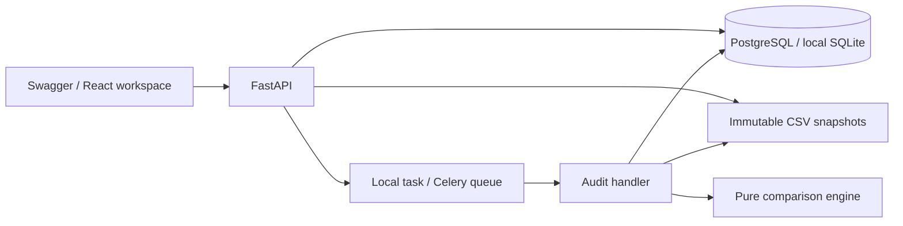

# Architecture and extension roadmap

## Scope of the local auditor

This is a local, single-user application with immutable CSV snapshots, deterministic
field and relationship comparisons, and downloadable reports. The React workspace
supports project creation, uploads, visual contracts, audit history, execution
status/retry, and report inspection. Swagger exposes the same API directly.
It is not a hosted SaaS or certification of a complete migration. Only explicitly
mapped fields, record IDs, and declared relationships are checked.
The source CRM is never contacted and neither CRM is modified.

## Boundaries

- `domain/`: typed audit contracts, strict CSV parsing, deterministic comparisons.
  No HTTP, SQLAlchemy, Celery, or filesystem imports in the engine. Test this layer
  with synthetic fixtures and business examples before exposing new rules through HTTP.
- `services/`: load immutable inputs, verify their SHA-256 checksums, invoke the
  engine, and persist a report. `LocalStorage` is the first storage adapter; an S3
  adapter should preserve its `put/read/delete` behavior and size enforcement.
- `api/`: request validation, project scoping, file admission, dispatch, and status.
  It stores an immutable contract snapshot with every run; changing a rule means
  submitting a new run, preserving historical evidence.
- `workers/`: Celery receives only an audit UUID. The database is the source of job
  state. The same use case runs in a thread after the response for local development.
- `frontend/`: independent React + Vite workspace with hash-based project/audit
  routes, abortable reads, mutation-specific state, and terminal-aware polling.
  The guided demo imports the canonical CSV/contract examples and submits real
  API operations, not canned reports. Development/preview proxy same-origin
  requests through Vite; Compose serves built assets through nginx. Audit
  semantics remain in Python, with backend validation authoritative.

The three database tables are projects, datasets, and audit_runs. Findings are a
bounded JSON report on an audit run. The browser filters and paginates retained
evidence locally; total counts and truncation state remain visible. Move findings
to a dedicated table before adding exhaustive server-side finding queries or
per-finding acceptance decisions. JSON columns keep the current schema portable
between SQLite and PostgreSQL.

Browser contract previews validate exact headers, map uniqueness, relationship
references, and normalized decimal tolerance bounds without binary-float rounding.
Historical contracts cannot be edited. Drafts survive project-tab switches, not
route departure; changes require a new run. A completed run's loaded report remains
visible if execution refresh fails, alongside the last-known-state warning.

The frontend container builds from the repository root so the canonical examples
are available without maintaining fixture copies. A Dockerfile-specific ignore
file excludes dependencies, local secrets, and generated artifacts; the backend
image retains its separate frontend exclusion. nginx preserves API paths and
resolves the API service through Docker DNS after container recreation. Compose
exposes only loopback browser/API ports. No proxy authentication bypass or
browser-embedded API key is added.

CI checks locked Python dependencies, domain/API behavior, PostgreSQL migrations,
and the built browser workspace against an isolated real SQLite API. Browser
checks are not proof of Celery dispatch or container-runtime correctness.

## Relationship contracts

The existing two-dataset contract remains valid. `parent_pairs` optionally names
up to ten source/target parent dataset pairs. Each pair declares dataset UUIDs,
exact `source_key`/`target_key` column names, and an optional one-to-one `key_map`.
Names contain letters, digits, underscores, and hyphens, start with a letter, and
are at most 64 characters. Every declared pair must be referenced by at least one
relationship rule.

Up to fifty `relationships` select the child source/target reference columns and
their `parent_pair`. Contracts can omit `fields` for relationship-only audits,
but must contain at least one field or relationship rule. Parent datasets must
belong to the same project and have the requested source/target side and key
headers. All input files are checksum-verified before comparison; each unique
dataset is loaded once per execution, and each parent pair is indexed once.

For each matched child, the engine resolves its source parent through the explicit
crosswalk (identity for unmapped IDs), requires uniquely identified source and
target parents, and compares the target reference with the expected target ID.
An incorrect-but-existing parent produces `relationship_mismatch` and a failed
verdict. A missing source, actual target, or expected target parent produces
`missing_parent` and `not_verified`: parent identity cannot be verified. Duplicate
or empty parent IDs and crosswalk/identity collisions also make the report
`not_verified`, even when findings are truncated. Many-to-one crosswalks are
rejected instead of guessing how merged records should be treated.

References use exact strings, without value normalization. Empty references are
valid only when both cells are exactly empty and the rule explicitly sets
`allow_empty: true`. One empty cell never passes. Parent snapshots with no records
remain unverified. Parent field equality, complete parent migration coverage, and
transitive links are not implied: audit contacts against company pairs, then
audit deals against contact and/or company pairs to cover a hierarchy explicitly.

Reports retain `source` and `target` input hashes and add
`parent:{pair_name}:source` and `parent:{pair_name}:target`. Relationship findings
include `dataset_pair` and `relationship` (the target reference column).
`compared_relationships` counts only links for which comparison was conclusive,
including explicitly allowed empty links. Findings remain bounded and ordered;
total finding counts and verdicts cover all admitted inputs.

JSON and CSV downloads use the same project scoping, optional API key, and
completed-run requirement as the report endpoint. Downloads include scope,
truncation, totals, and snapshot hashes; a CSV export is not an exhaustive findings
archive when the stored report is truncated.

## Exact input semantics and readiness

CSV header names are preserved and contract selectors address them exactly,
including leading/trailing spaces. Decimal values accept signed ASCII digits,
an optional decimal point, and an optional exponent; whitespace requires an
explicit `strip` normalizer. Underscores, non-ASCII numerals, non-finite values,
and values outside the documented numeric bounds are unverified.

Readiness probes all mapped columns in projects, datasets, and audit runs without
loading records. A partial or outdated schema is not ready. This does not verify
worker availability or replace migrations.

## Job semantics

Normal lifecycle: `queued -> running -> completed | failed`.
A completed job can have a `passed`, `failed`, or `not_verified` report verdict.
Execution failures have a generic error code and no report. Only `failed` executions
can be requeued with the retry endpoint. Use a new audit run for corrected uploads.

An atomic SQL update claims a queued job. Concurrent duplicate deliveries cannot
claim the same run, and completed runs are not executed again. This is not an
exactly-once delivery guarantee. The initial claim and task dispatch are separate
transactions: a crash between them can strand a queued run. Local background tasks
also disappear on process shutdown; worker crashes can strand running runs.

For this starter, submit a new audit with the same dataset IDs and contract after
an interrupted run. Keep the old run as evidence. Automatic recovery, progress,
cancellation, time limits, and resumable chunks are future work. Add a transactional
outbox for dispatch and expiring worker leases with attempt tokens/fencing before
offering reliable hosted processing. Retry logic must distinguish infrastructure
errors from invalid inputs and must never overwrite a newer attempt's result.

## Data and access boundaries

- Default development binding is localhost. An optional shared API key gates the
  business endpoints. Project IDs provide organization, not user authorization.
- Add authenticated users, organizations, memberships, and ownership checks on every
  resource and job before allowing multiple customers. Test cross-tenant access.
- Upload filenames never become filesystem paths. The server generates UUID names.
  Uploads have bounded admitted byte/row/column counts and strict UTF-8 CSV parsing.
- The starter checks CSV size after multipart parsing. A public deployment also needs
  request-body limits before parsing, rate limits, quotas, and upload timeouts at
  the reverse proxy/storage layer. Bind mounts and storage are trusted server resources.
- The parser materializes admitted CSVs in memory. This is intentional for the small
  starter limits; larger datasets need chunking or an analytical engine, resource
  budgets, and benchmarks before increasing those limits.
- Uploaded values appear in reports for review. They are not logged. Error logs include
  only audit UUID and exception type. Authentication tokens and broker/database URLs
  must never be logged. Report downloads require the same authorization as their inputs.
- Local storage has no application-layer encryption, retention policy, or deletion API
  yet. Add encrypted storage, signed download access, backups, cleanup/retention, and
  project deletion before accepting real customer records.
- A hash proves which bytes were examined; it does not prove export completeness.
  Add an export manifest covering scope, filters, timestamps, selected fields, and
  association completeness. Missing coverage should be reported as unverified.

## Further milestones

Relationship verification and bounded report downloads are implemented. Remaining
roadmap items are not requirements of the local single-user deliverable:

1. **Relationship extensions:** human-approved merge rules and richer association
   exports. Current single-parent references deliberately reject ambiguous merges.
2. **Review workflow:** persist individual findings and append-only acceptance
   decisions with reviewer, reason, and timestamp. Link corrected runs and show
   resolved/unresolved findings. Current evidence inspection does not imply
   persistent human approval.
3. **AI mapping suggestions:** define a provider interface that returns proposed
   `FieldRule` objects with evidence and confidence. Require approval before storing
   a contract. Start with column metadata and synthetic examples, add an evaluated
   benchmark against a simple name-matching baseline, and keep final checks deterministic.
4. **Hosted operation:** tenant authentication/authorization, real worker recovery,
   S3 storage, retention, observability, migration tests on PostgreSQL, and billing.
5. **Connectors:** read-only CRM exports with rate-limit handling, completeness
   manifests, and permission scoping. Maintain CSV admission as an independent path.

## Framework references

- FastAPI background tasks: https://fastapi.tiangolo.com/tutorial/background-tasks/
- SQLAlchemy ORM: https://docs.sqlalchemy.org/en/20/orm/quickstart.html
- Alembic: https://alembic.sqlalchemy.org/en/latest/tutorial.html
- Celery: https://docs.celeryq.dev/en/stable/getting-started/introduction.html

These references explain the framework behavior. Product design choices above are
specific to this starter and should evolve as you validate requirements.
