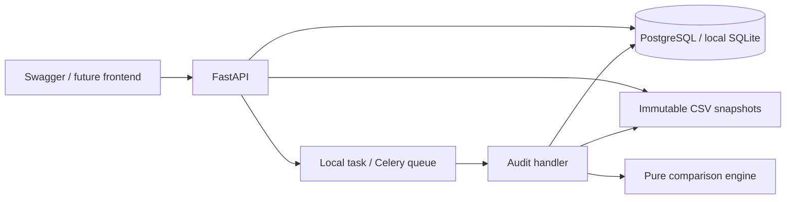

# Architecture and extension roadmap

## Scope of this starter

This is a local, single-user backend foundation with a functioning vertical slice.
It is not yet a hosted SaaS, a full CRM migration tool, or a certification of a
complete migration. Only explicitly mapped fields in two uploaded tables are checked.
The source CRM is never contacted and neither CRM is modified.

## Boundaries

- `domain/`: typed audit contracts, strict CSV parsing, deterministic comparisons.
  No HTTP, SQLAlchemy, Celery, or filesystem imports in the engine. Test this layer
  with synthetic fixtures and business examples before exposing new rules through HTTP.
- `services/`: load immutable inputs, verify their SHA-256 checksums, invoke the
  engine, and persist a report. `LocalStorage` is the first storage adapter; an S3
  adapter should preserve its `put/read/delete` behavior and size enforcement.
- `api/`: request validation, project scoping, file admission, dispatch, and status.
  It stores an immutable contract snapshot with every run; changing a rule means
  submitting a new run, preserving historical evidence.
- `workers/`: Celery receives only an audit UUID. The database is the source of job
  state. The same use case runs in a thread after the response for local development.

The three database tables are projects, datasets, and audit_runs. Findings are a
bounded JSON report on an audit run. Move them to a dedicated table when you add
paginated review, filtering, and per-finding acceptance decisions. JSON columns
keep the initial schema portable between SQLite and PostgreSQL.

## Job semantics

Normal lifecycle: `queued -> running -> completed | failed`.
A completed job can have a `passed`, `failed`, or `not_verified` report verdict.
Execution failures have a generic error code and no report. Only `failed` executions
can be requeued with the retry endpoint. Use a new audit run for corrected uploads.

An atomic SQL update claims a queued job. Concurrent duplicate deliveries cannot
claim the same run, and completed runs are not executed again. This is not an
exactly-once delivery guarantee. The initial claim and task dispatch are separate
transactions: a crash between them can strand a queued run. Local background tasks
also disappear on process shutdown; worker crashes can strand running runs.

For this starter, submit a new audit with the same dataset IDs and contract after
an interrupted run. Keep the old run as evidence. Automatic recovery, progress,
cancellation, time limits, and resumable chunks are future work. Add a transactional
outbox for dispatch and expiring worker leases with attempt tokens/fencing before
offering reliable hosted processing. Retry logic must distinguish infrastructure
errors from invalid inputs and must never overwrite a newer attempt's result.

## Data and access boundaries

- Default development binding is localhost. An optional shared API key gates the
  business endpoints. Project IDs provide organization, not user authorization.
- Add authenticated users, organizations, memberships, and ownership checks on every
  resource and job before allowing multiple customers. Test cross-tenant access.
- Upload filenames never become filesystem paths. The server generates UUID names.
  Uploads have bounded admitted byte/row/column counts and strict UTF-8 CSV parsing.
- The starter checks CSV size after multipart parsing. A public deployment also needs
  request-body limits before parsing, rate limits, quotas, and upload timeouts at
  the reverse proxy/storage layer. Bind mounts and storage are trusted server resources.
- The parser materializes admitted CSVs in memory. This is intentional for the small
  starter limits; larger datasets need chunking or an analytical engine, resource
  budgets, and benchmarks before increasing those limits.
- Uploaded values appear in reports for review. They are not logged. Error logs include
  only audit UUID and exception type. Authentication tokens and broker/database URLs
  must never be logged. Report downloads require the same authorization as their inputs.
- Local storage has no application-layer encryption, retention policy, or deletion API
  yet. Add encrypted storage, signed download access, backups, cleanup/retention, and
  project deletion before accepting real customer records.
- A hash proves which bytes were examined; it does not prove export completeness.
  Add an export manifest covering scope, filters, timestamps, selected fields, and
  association completeness. Missing coverage should be reported as unverified.

## Suggested next milestones

1. **Relationship verification:** extend a contract to reference multiple dataset
   pairs plus explicit ID crosswalks. Compare source-to-target relationships, not
   only whether referenced parents exist. Add company/contact/deal fixtures with
   incorrect-but-existing parents, missing parents, duplicates, and merged records.
   Preserve human-approved merge rules rather than allowing fuzzy matches to pass.
2. **Review workflow:** persist individual findings and append-only acceptance
   decisions with reviewer, reason, and timestamp. Link corrected runs and show
   resolved/unresolved findings. Add a report export and a minimal frontend.
3. **AI mapping suggestions:** define a provider interface that returns proposed
   `FieldRule` objects with evidence and confidence. Require approval before storing
   a contract. Start with column metadata and synthetic examples, add an evaluated
   benchmark against a simple name-matching baseline, and keep final checks deterministic.
4. **Hosted operation:** tenant authentication/authorization, real worker recovery,
   S3 storage, retention, observability, migration tests on PostgreSQL, and billing.
5. **Connectors:** read-only CRM exports with rate-limit handling, completeness
   manifests, and permission scoping. Maintain CSV admission as an independent path.

## Framework references

- FastAPI background tasks: https://fastapi.tiangolo.com/tutorial/background-tasks/
- SQLAlchemy ORM: https://docs.sqlalchemy.org/en/20/orm/quickstart.html
- Alembic: https://alembic.sqlalchemy.org/en/latest/tutorial.html
- Celery: https://docs.celeryq.dev/en/stable/getting-started/introduction.html

These references explain the framework behavior. Product design choices above are
specific to this starter and should evolve as you validate requirements.
